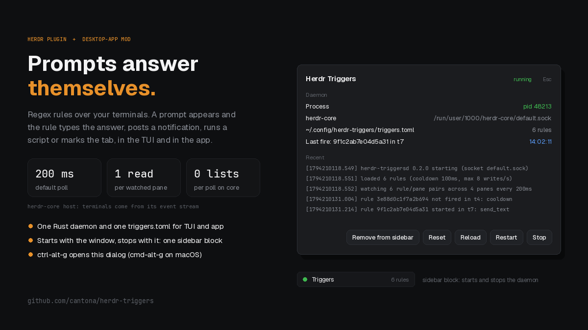
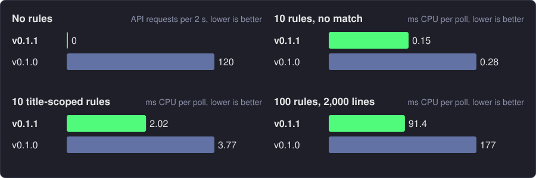

<h1 align="center">herdr-triggers</h1>

<p align="center"><b>Watch every pane. Answer the prompt. Raise the alarm.</b></p>

<p align="center">
<a href="LICENSE"></a>

<a href="https://github.com/cantona/herdr-triggers/tags"></a>
</p>

<p align="center">
herdr-triggers watches your herdr panes, and the Herdr desktop app's
terminals, for any regex you write. The moment it appears, a rule acts: it
types the answer, posts a notification, runs a script, or marks the tab.
One <code>triggers.toml</code> serves the herdr TUI and the desktop app.
</p>

<p align="center"></p>

## Why you want it

A console waits at `login:`. A build finishes three tabs away. A log prints
`Failed password ... from 203.0.113.7` while you are reading something else.
Without triggers you notice late, or you type the same answer for the
hundredth time. With herdr-triggers, the terminal tells you, or answers
itself.

- **Any regex, any pane.** Aim a rule at the panes you mean by pane, tab or
  workspace name (`scope = { pane_title = "console.*" }`), or let it watch
  everything.
- **Five actions.** `send_text` types into the pane, `notify` raises a
  notification, `run` starts a script, `coprocess` types back a script's
  answer (fed the screen with `feed_screen = true`), and `tab_mark` marks
  the tab until you rename it.
- **Secrets stay secret.** `${secret:NAME}` comes from a `secrets.toml` that
  must be mode 0600. It is read at fire time, never written to the log, and
  refused in a subprocess's argv, where every user could read it
  (`secret_env` passes it as an environment variable instead).
- **Safe by default.** `tail_within` answers only the prompt actually
  waiting at the bottom of the screen, not one that has scrolled up. Text
  already on screen when a rule arms does not fire it. `once` fires once per
  terminal, and write bursts are capped, so a rule cannot spin.
- **Fast and light.** It checks the screen every 200 ms by default and
  answers on the next check, where herdr's own output subscription took 1 to
  72 s in measurements. In the TUI it makes no requests while it has no
  rules, and it stayed around 3 to 7 MiB of memory in the
  [benchmarks](#benchmarks).
- **Both hosts.** It runs as a herdr TUI plugin, and in the desktop app as a
  login service that waits for herdr-core and follows it.

## Quick start

You need Linux or macOS, a Rust toolchain (the install builds from source),
and herdr 0.8.2 or newer, or the Herdr desktop app.

### herdr TUI

```sh
herdr plugin install cantona/herdr-triggers --ref v0.2.2
herdr plugin action invoke triggers-start --plugin cantona.herdr-triggers
$EDITOR "$(herdr plugin config-dir cantona.herdr-triggers)/triggers.toml"
herdr plugin action invoke triggers-reload --plugin cantona.herdr-triggers
```

Every herdr server start starts the daemon after that; the first `start`
covers the session you installed it in.

### Herdr desktop app

Open the app once first, so it writes its `keys.json`. Then:

```sh
cargo install --locked --git https://github.com/cantona/herdr-triggers
herdr-triggersd install          # shows what it will change, asks y/N
mkdir -p ~/.config/herdr-triggers
$EDITOR ~/.config/herdr-triggers/triggers.toml
herdr-triggersd --host core reload
```

`install` adds a dialog (`ctrl-alt-g`, `cmd-alt-g` on macOS), an optional
sidebar status block, and a login service: a systemd user unit on Linux, a
launchd agent on macOS. If the TUI plugin's config folder exists when you
run `install`, and `~/.config/herdr-triggers` does not yet, `install` links
the two, so both hosts run the same rules.

Nothing fires until you write a rule.

## Two rules to start from

Answer a device's login prompts from the 0600 secrets file:

```toml
[[rules]]
regex       = "Password:"
once        = true
scope       = { pane_title = "console.*" }
tail_within = 2          # only the prompt still waiting at the screen tail
action      = { type = "send_text", text = "${secret:DEVICE_PASS}\n" }
```

Alert on a failed SSH login in a pane tailing the auth log:

```toml
[[rules]]
regex  = "(?i)(failed password|invalid user).*from [0-9a-fA-F.:]+"
scope  = { pane_title = "(?i)monitor" }
action = { type = "notify", title = "Failed SSH auth", body = "${match}",
           desktop = "critical" }
```

The [guide](docs/GUIDE.md#example-automated-login) walks through both, with
what each setting guards against.

## What you can do

| You want to... | herdr TUI (plugin action) | Desktop app (terminal) |
| --- | --- | --- |
| Start the daemon | `triggers-start` | `herdr-triggersd --host core start` |
| Pick up edited rules | `triggers-reload` | `herdr-triggersd --host core reload` |
| Re-arm every `once` rule | `triggers-reset` | `herdr-triggersd --host core reset` |
| See state and recent fires | `triggers-status` | `herdr-triggersd --host core status` |
| Stop it | `triggers-stop` | `herdr-triggersd --host core stop` |

The desktop app's dialog shows the same state and runs these commands. A
daemon runs per server, so with several herdr sessions use `--session NAME`
or `--all`; the [guide](docs/GUIDE.md#targeting-a-server) explains why.

## Benchmarks

<p align="center"></p>

| Workload (32 panes, `poll_ms = 50`) | 0.1.0 | 0.1.1 | Reduction |
|---|---:|---:|---:|
| No rules: API requests per 2 s | 120 | **0** | 100% |
| 10 pane-ID rules, no matching pane: CPU per poll | 0.281 ms | **0.152 ms** | 46% |
| 10 title-scoped rules, 200 lines per pane: CPU per poll | 3.766 ms | **2.022 ms** | 46% |
| 100 pane-ID rules, 2,000 lines per pane: CPU per poll | 177.2 ms | **91.4 ms** | 48% |

0.1.1 made polling this cheap, and 0.2.2 polls at about the same cost.
Medians of nine two-second samples per workload, measured on 2026-11-18 on
Linux x86_64 (i7-10700) with release builds of the tags, using
`scripts/benchmark.py`: a private fake herdr API, synthetic screens and
rules that never fire. Peak memory stayed between 3.7 and 6.5 MiB. These
are the daemon's own costs, not the time until a rule fires or herdr's own
CPU. The raw samples, 0.2.2 included, are in
[`docs/benchmarks/linux-2026-11-18.json`](docs/benchmarks/linux-2026-11-18.json),
and the chart is drawn from them:

```sh
scripts/bench-chart.py assets/bench.svg docs/benchmarks/linux-2026-11-18.json v0.1.0 v0.1.1
```

The [guide](docs/GUIDE.md#isolated-performance-benchmark) explains how to
run the benchmark.

## What it does not do

- **It reads screens, not streams.** Text that appears and scrolls away
  within one poll can be missed. Prompts wait for input, so they are always
  seen; a fast build log is a poor fit.
- **It does not see the cursor.** herdr exposes none, so `tail_within` is
  how a rule tells the waiting prompt from an old one. Put it on every rule
  that types a secret.
- **It watches at most 32 panes.** `scope` keeps the work small.
- **No inline highlight.** herdr has no API for it; `tab_mark` stands in.
- **Windows is not supported.**

The guide's [matching section](docs/GUIDE.md#how-matching-actually-works-and-what-it-costs)
and [known limitations](docs/GUIDE.md#known-limitations-of-this-build) have
the details.

## Documentation

- [Guide](docs/GUIDE.md): install, the desktop app host, examples, scopes,
  plugin actions, the rule schema, secrets, matching and its costs, limits
  and testing.
- [Dialog recipe](RECIPE.md): what the desktop app dialog shows and does.
- [Changelog](CHANGELOG.md).

## Contributing

```sh
cargo fmt --check
cargo clippy --locked --all-targets -- -D warnings
cargo test --locked
```

`cargo test` runs the daemon against a fake herdr-core; the guide's
[testing section](docs/GUIDE.md#testing) has the live integration test and
the benchmark.

## License

Copyright 2026 Su Kang Yin. Licensed under the [Apache License 2.0](LICENSE).
