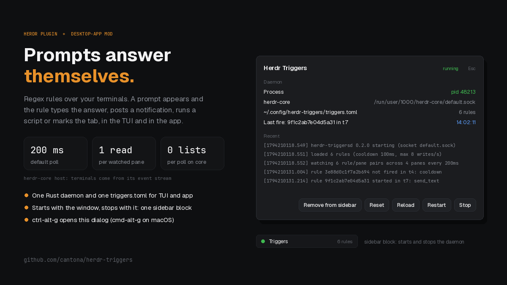

# Herdr Triggers

Regex triggers over your terminals, inside the Herdr desktop app. The same
`herdr-triggersd` that runs as a herdr TUI plugin watches herdr-core's
terminals: a prompt matches, and the rule types the answer, posts a desktop
notification, runs a script or marks the tab. One `triggers.toml` serves both.

A dialog, opened with `ctrl-alt-g` (`cmd-alt-g` on macOS), shows the daemon
and runs its commands. A small sidebar block starts the daemon when the
window opens, and the daemon leaves by itself once the app has quit.



## Install

```sh
cargo install --locked --git https://github.com/cantona/herdr-triggers
mkdir -p ~/.config/herdr-app/mods
cp -r mods/herdr-triggers ~/.config/herdr-app/mods/
```

Merge `keys.json` into `~/.config/herdr-app/keys.json`.

Rules and secrets live in `~/.config/herdr-triggers/` (`triggers.toml`, and
`secrets.toml` with mode 0600). If you use the TUI plugin too, share its
directory with one symlink:

```sh
ln -s ~/.config/herdr/plugins/config/cantona.herdr-triggers ~/.config/herdr-triggers
```

The rule schema is in the README.

## What you see

**Dialog:** 560px wide, the theme's `popover` color, 18px padding, 8px
corners, 13px text.

- **Title row:** "Herdr Triggers" in 15px semibold `foreground`; the state
  word on the right: "running" (`working`), "stopped" (`idle`), "error"
  (`blocked`); a dim "Esc" hint.
- **Daemon:** the process (`pid N` or "not running"), the herdr-core socket,
  the config path with its rule count (or "config error" and the message),
  and the last fire: rule, terminal and local time.
- **Recent:** the last 20 daemon log lines in monospace, scrolling past
  220px. Fires, declines ("already on screen at startup", cooldowns) and
  failures all show here.
- **Buttons:** Start (primary) or Stop, Restart, Reload, Reset, and one
  sidebar button, whichever applies: "Clone layout for sidebar", "Switch to
  <name>-triggers" (the clone exists already), "Add to sidebar", "Remove
  from sidebar", or "No sidebar in this layout".

**Sidebar block:** 30px high, in the left sidebar above its footer. An 8px
dot in the same state colors, "Triggers", and the rule count in `dim`. Below
80px wide only the dot shows. Click it to open the dialog.

## How it behaves

- **Start and stop follow the app.** The block's `init` runs
  `herdr-triggersd --host core --follow-app start` (idempotent). A daemon
  started with `--follow-app` checks every 5s that the app's socket
  (`~/.config/herdr-app/herdr-app.sock`, or under `HERDR_APP_HOME`)
  answers, and exits once it has not for 10s, so an update's restart does
  not stop it. The dialog's Start and Restart pass the same flag. Without
  the block in the shown layout nothing starts automatically; use Start.
- **Stop holds.** After Stop the block does not start the daemon again, not
  on a layout switch, a mod reload or the next launch, until Start or
  Restart. The dialog shows "The sidebar starts it: no" meanwhile.
- **Adding the block.** Shipped layouts refuse structural edits. On a
  shipped layout the button first clones it to `<name>-triggers` and the app
  switches to the clone; press "Add to sidebar" then. The block is inserted
  into the layout node `sidebar`, before `sidebar-footer`. For a layout
  without a `sidebar` column, place it by hand:

  ```json
  { "id": "herdr-triggers", "type": "block", "size": { "px": 30 },
    "content": { "mod": "herdr-triggers", "props": { "strip": true } } }
  ```

- **Rules fire as in the TUI.** `poll_ms` (default 200ms), `cooldown_ms`,
  `max_writes_per_second`, `tail_within` and `once` are the same code.
- **Cost.** The daemon learns about terminals from herdr-core's event stream;
  a poll reads only the screens a rule watches. Typing goes to the terminal
  as raw bytes through `terminal.attach`, exactly the rule's text.
- **The core leaving.** The daemon exits after herdr-core has been
  unreachable for 30s.
- **No timers in the mod.** Status is read when a copy starts and after each
  button. The block renders the state word and rule count the dialog
  shares; the log and messages stay in the dialog, because the app saves
  shared values to a file other local users can read.

## Differences from the TUI host

| Action | herdr TUI | Herdr app (herdr-core) |
|---|---|---|
| `notify` | herdr's toast, plus a desktop notification when `desktop` is set | a desktop notification only; the dialog's log shows the fire |
| `tab_mark` | `tab.rename` | `herdr-app do tab.rename`; needs the window open |
| `[settings] source` | `visible`, `recent`, ... | ignored: the daemon reads only the screen; `lines` keeps its last N lines |
| `pane_title` scope | pane title, tab label, workspace label | terminal title, space name, tab name |

## Command line

```sh
herdr-triggersd --host core status --json
herdr-triggersd --host core start|stop|restart|reload|reset
herdr-triggersd --host core status --session work   # another hc session
herdr-triggersd --host core restart --all           # every hc session
herdr-triggersd --host core status --json --all     # one JSON object per line
```

State lives in `~/.local/state/herdr-triggers/core-<session>/`.

## Built from

- `herdr` module: `exec`, `props`, `closeOverlay`, `theme`, `notify`, `run`,
  `layout`, `layouts`, `shared`, `setShared`.
- `gpui-kit` / `gpui-base`: `View`, `div`, `h_flex`, `v_flex`.
- App commands: `mod.open`, `layout.clone`, `layout.switch`, `layout.set`.
- `herdr-triggersd --host core status --json` for every fact. No network,
  no `hc`. No art.

## Watch out

- `herdr-triggersd` must be on the PATH the app process has: `exec` runs it
  by bare name. `cargo install` puts it in `~/.cargo/bin`, which a Linux
  desktop session started outside your shell may not have; link it into a
  directory that session has (for example `~/.local/bin`) if the dialog
  says herdr-triggersd could not be started.
- The dialog acts on the herdr-core session that `HC_SESSION` names in the
  environment the app's `exec` provides (`default` without it).
- A daemon started from a terminal without `--follow-app` is left running
  when the app finds it; the dialog shows "Leaves when the app quits: no"
  until Restart starts it with the flag.
- Switching to a layout without the block leaves the daemon running; it
  stops when the app quits, or with Stop.
- On herdr-core a `notify` that the desktop notifier could not show (it is
  missing or it failed) keeps the rule armed, so a `once` rule is not used
  up; it is retried with backoff, as a missing `run` program is.
- The block starts the daemon when it first shows. With the sidebar column
  hidden at launch nothing starts until it is shown, or until Start.
- `tab_mark` takes the tab's name from herdr-core's `where` label. On a tab
  nobody named, that is its number, so marking it names it ("! 1"), and the
  name no longer follows the tab's place; rename it to "" to undo. A space
  name containing " / " confuses the split.
- A rule that types a credential belongs on a scoped, `tail_within` rule, as
  in the TUI. The app's terminals are watched only while the daemon runs.

## Done when

- `herdr-app check mods/herdr-triggers` passes.
- `ctrl-alt-g` (`cmd-alt-g` on macOS) opens the dialog; Esc closes it.
- Start makes the state word "running"; Stop makes it "stopped".
- With the block in the sidebar, the daemon is gone within about 20s of
  quitting the app (one check every 5s, then 10s of patience), and
  reopening the app starts it again.
- With `herdr-triggersd` off PATH, the dialog shows the install command.
